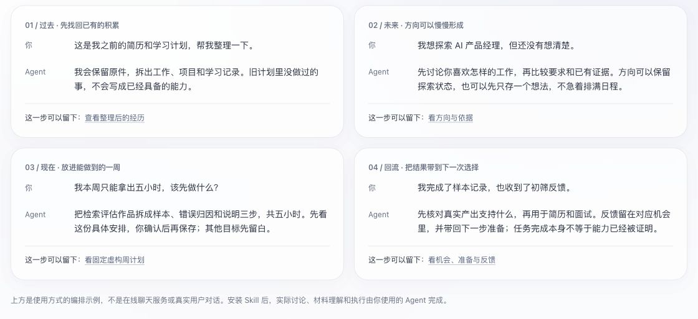

# LüJi（履迹） · キャリアを、日々の成長につなぐ

[简体中文](README.md) · [English](README.en.md) · 日本語 · [한국어](README.ko.md) · [Español](README.es.md)

**使い慣れたAgentを、経験・今日の行動・これからの方向をつなぐ、あなたのキャリア相談相手に。**



```text
https://github.com/siliviasilivia85-lang/lvji-career-kit からこのSkillをインストールして有効にし、一つの経験を一緒に整理してください。
```

[インストールと対応する環境](references/install.md) · 一度設定すれば、あとは普段どおりに話せます。

## LüJiを作る理由

キャリアの次の一歩を真剣に考え始めるのは、いまの仕事では成長を感じにくくなってから。そんな経験を持つ人は少なくありません。

転職が必要になって初めて、昔のプロジェクトを探し、レジュメを書き直し、進みたい方向を考える。これまで取り組んだことも学んだこともあるのに、記録はあちこちに散らばっていて、自分に何が積み重なっているのかを説明しにくい。いくつかの職種を検討すれば、それぞれに合った応募書類も必要になります。次の一歩が見えないまま、転職のための転職を急いでしまうことがあります。

けれど、力が身につくには時間がかかります。レジュメは数日で書き直せても、確かな実践や、別の仕事にも活かせる力は、日々の積み重ねから生まれます。AIが仕事の境界や求められる力を変えていくいま、キャリアの準備にも、普段の仕事や暮らしの中に居場所が必要です。

**LüJiは、成長が続いていくキャリアの道筋を一緒に整理するためのSkillです。これまでの蓄積を見つけ直し、これからの目標を今日の行動につなげ、その成果を次の選択へと持ち運べるようにします。**

使い慣れたAgentに、考え方とローカルファイルのツール、可視化の仕組みを渡し、あなた専属のキャリア相談相手として使えるようにします。経験を整理し、行動を分け、成果や機会を振り返る。その繰り返しを、読み返せるファイルに残していきます。

## これまで・いま・これからをつなぐ

### これまで：歩んできた道から、成長の手がかりを見つける

過去の仕事、プロジェクト、学習の過程や経験を、名前の付いた小さな記録に分けて残します。原本と出典を保ち、あとから思い出したことも補足できます。Agentはそこから、経験や好み、別の場面にも活かせる力を一緒に見直します。次の選択は、過去とは違う方向に進むものであってもかまいません。

### いま：遠い目標に、実際の一週間の中でできることを見つける

目の前には仕事があり、使える時間には限りがあり、予定が崩れることもあります。LüJiは、いまの状況と確保できる時間に合わせて、やりたいことをプロジェクト、段階ごとの成果、日・週・月の行動へと分けます。うまく進まないときは、一歩を小さくし、ペースを変え、続ける価値を改めて考えられます。

### これから：いくつもの可能性に、同じ蓄積を活かす

将来の方向は、一つに絞る必要はありません。異なる職種にも共通する力があり、一つのプロジェクトや学習、仕事の実践が、いくつかの可能性を支えることがあります。LüJiはそのつながりを整理し、目標に必要な力を、いま積み重ねる経験と行動へ戻して考えます。

実際に応募するときには、過去と現在の蓄積から内容を選び、職種や企業に合わせたレジュメと面接資料を作ります。応募の進み具合、面接での経験、フィードバックも残し、それを次の判断や日々の行動に活かします。

行動が終わったことと、力を裏づけられることは別です。完了したタスクは、まず普通の記録として残せます。作品や実際の成果、フィードバックをあなたが確かめて初めて、どの力をどこまで示せるかを考えます。**実践のたびに蓄積が残り、選択のたびに理解が深まる。その連続を、キャリアの軌跡にしていきます。**

つながりは少しずつ作れます。探索するだけでも、目標にしないアイデアを残すだけでもかまいません。大切な内容は具体的な下書きにし、確認してから保存します。

## はじめ方：一つの経験を整理してみる

最初は、よく覚えているプロジェクト、仕事、学習経験を一つ選んでください。以前のレジュメの一部、振り返り、学習メモなどで十分です。手元に資料がなければ、経緯を書き出すことから始められます。完全なキャリアの記録を、一度に用意する必要はありません。

過去の資料がまだなくても、いま試してみたいことから話を始められます。経験はあとで追加できますし、まだ決めていないアイデアだけを保存することもできます。

1. **自分のワークスペースを作る。** ダウンロードしたフォルダを、普段使うAgentで開くか、アクセスを許可します。ルートの `AGENTS.md` と `SKILL.md` を読み、個人ワークスペースを作って資料マップを見せるよう伝えてください。初期設定のあとは、普段どおりに会話できます。ファイルの一連の操作には、Agentによるローカルファイルの読み書き・コマンド実行と、Python 3.10+が必要です。
2. **その経験の資料を入れる。** ワークスペースの `past/materials/` に置きます。分類が分からなければ `inbox/` でかまいません。Agentに添付して、取り込みと整理を頼むこともできます。直接置いた原本の名前と場所は変えません。普通のメモ、PDF、Word、画像に内部用の項目を記入する必要はありません。添付資料を正確に読み取れるかは、使うAgentに依存します。
3. **一緒に整理し、確かめる。** Agentが、何を行い、何を担当し、何を残したかを、出典と不明点を添えた下書きにします。漏れを補い、誤りを直し、その版を確認してから、読みやすいMarkdownの正式記録として保存します。原本も残ります。記録の本文は自分で編集できます。タスクの日付や状態には専用の項目があるため、変更はAgentに頼むと簡単です。
4. **全体を見てみる。** ワークベンチの生成と表示を頼みます。「总览」の「来路与当前理解」を開くと、整理した記録の本文と出典を確認できます。修正はAgentに頼むか、Markdownを編集してページを再生成します。現在のWebページは閲覧と選択用で、ページ内から直接保存する機能はありません。
5. **次の一歩につなげる。** いまの関心や使える時間に合わせて、進める意味のあるプロジェクトや行動を考えます。将来の方向に関連づけても、独立させてもかまいません。保存すると決めたら、統一プランで予定を確認できます。

日本語で会話できますが、生成されるワークスペースのガイドは現在、中国語・英語のみです。初期設定では `zh` または `en` を選んでください。中国語の開始ファイルは `从这里开始.md`、英語は `START-HERE.md` です。この日本語READMEの追加によって、ガイドや画面全体が日本語化されたわけではありません。

最初の整理が終わったら、原本の場所が分かり、整理結果を読んで直せて、次の会話から続けられる状態になるはずです。先に架空の資料で試したい場合は、[試用ガイド](examples/try-it.md)に従い、新しい一時ディレクトリで操作するようAgentに頼んでください。

## 日々の資料を置く場所

以下はすべて個人ワークスペース内のパスです。新しく始める場合は、Skillのインストール先とは別の `~/lvji-workspace/` を推奨します。既存のワークスペースは確認済みの場所を使い続け、自動では移動しません。

| 手元にあるもの | 置く場所 |
| --- | --- |
| 以前のレジュメ、証明書、過去の仕事・プロジェクトの資料、学習メモ | `past/materials/`。テーマごとのサブフォルダを作れます |
| いま取り組んでいることの共通資料 | `present/materials/` |
| 特定の継続的な取り組みに属する資料 | `present/items/<item>/materials/` |
| まだ分類していない求人票（JD）や職業の方向性に関する資料 | `future/materials/` |
| 特定の方向・企業の応募先に関するJD、スクリーンショット、フィードバック | その方向・応募先の `materials/` |
| まだ分類が分からないもの | `inbox/` |

`MAP.md` は人が実際の資料を探すためのマップ、`AGENT-MAP.md` はAgentが必要な範囲だけを読むための案内です。両方とも同じ一覧から生成されるため、別々に管理する必要はありません。

ファイルは自分で直接置けます。Agentは関連する質問を扱うときに、その範囲の変更を確かめ、必要な資料だけを読みます。ファイルを見つけたこと、内容を理解したこと、経験の事実を確認したことは、それぞれ別の段階です。資料フォルダ内に自分で置いた `README.md` も資料として見つかります。除外されるのは、ツールが生成したと識別できる所定のガイドだけです。

ガイドとマップは中国語または英語で生成します。実際のディレクトリ名は `past/`、`present/`、`future/` のままにして、言語やAgentが変わっても参照を保ちます。自分で付けるファイル名やテーマ別フォルダ名には、日本語も使えます。言語を変えるために職業資料を移動する必要はありません。

[利用者向けマップ（英語）](references/map.en.md) · [Agentの読み方（英語）](references/agent-map.en.md) · [資料の発見と整理状態](references/navigation.md)

## 一つのワークベンチ、四つのビュー

**メインのワークベンチは、個人ワークスペースの `views/overview.html` に生成されます。** 一つのページの上部タブで、同じスナップショットの四つのビューを切り替えられます。

| ビュー（現在の画面表記） | 確認できること |
| --- | --- |
| **全体像（总览）** | 進行中の取り組み、今日の行動、最近の仕事・学習の進展。完了・一時停止した取り組み、保存したアイデア、節目の振り返りも展開できます |
| **統一プラン（统一计划）** | 日ごとの行動、週・月のカレンダー、年の見通し。同じ行動記録を異なる時間単位で表示します |
| **目指す方向（所向）** | 横並びの職業の方向性。根拠の充実度、情報の揃い具合、自分の優先度を分けて並べ替え、企業のJD、レジュメ、面接資料を開けます |
| **応募状況（投递进展）** | 各応募先の実際の段階、次の行動、履歴、フィードバック、実際に使ったレジュメの版。方向・企業・応募先・段階で絞り込めます。不明な版を最新の版と推定しません |

過去の経験は全体像の中にあり、独立した「過去」ページではありません。面接資料も、方向や応募先の詳細から開きます。原本と整理状態は `MAP.md` で確認できます。

Webレジュメは、版ごとに保存する別のHTMLです。職種共通版は `future/roles/<role>/common/resumes/<version>/`、企業別の版はその応募先の `resumes/<version>/` にあります。詳細の既存レジュメ一覧から開けます。六つのテンプレートは六つのレイアウトであり、六つのワークベンチではありません。

ページ内では絞り込み、並べ替え、詳細の閲覧ができます。本文、日付、応募段階を変更したいときは、Agentに変更を伝え、差分を確認して保存し、スナップショットを再生成します。Markdownを自分で編集することもできます。「请 Agent 调整」は依頼文をコピーするための補助機能です。日常の会話で毎回コピーする必要はありません。現在は、ページからの直接保存やドラッグ操作による予定変更の保存には対応していません。

**絞り込みは表示だけを変えます。ファイル内のデータを分離するものではありません。** 全体のスナップショットには、生成時に読み取った職業資料が含まれます。共有する場合は、内容の範囲を明確にした別の資料を作ってください。

画面の固定ラベルは、現在も主に中国語です。生成方法や実際の操作範囲は[可視化ガイド](references/views.md)にまとめています。`assets/md_workspace.html` はデータを入れて使うテンプレートのソースであり、そのまま開いても個人の資料は表示されません。

## レジュメと面接の準備

職種や特定の企業に合わせたレジュメをAgentに依頼できます。実際の経験と確認済みの成果から内容を選び、個人情報、自己紹介、職歴、プロジェクト、学歴、スキルを分けて整理し、出典を保ちます。JDの要件や模擬面接の回答を、そのままあなたの経験として書くことはありません。

### 先にレイアウトを見比べる

内蔵レイアウトは、自己紹介サイドバー、クラシックな一段組、根拠を整理した形式、簡潔なテキスト、プロジェクト優先、職歴優先の六つです。架空の同じ経験を使うギャラリーで比較でき、AIが生成した架空の顔写真A・B、または写真なしを選べます。選んだレイアウト名をAgentに伝え、実際の作成時に自分の経験と写真に置き換えます。

指定がなければ、自己紹介をサイドバーに置く二段組のレイアウトを使います。六つすべてを見比べなければ始められないわけではありません。

架空の顔写真は、デモと明示した例だけに使います。実際のレジュメは、あなたが指定した写真を使うか、写真を付けずに作成します。レイアウトと性別は結びつけません。

ギャラリーには、GitHub上のWebレジュメの参考例も七つあります。公式の例、用途、ライセンスへのリンクを示しますが、内蔵の六レイアウトとは別の外部参考です。リンクがあることは、そのテンプレートがインストール済みという意味ではありません。

### 確認した版を残す

レジュメは作成のたびに独立した版として保存します。そのHTMLを実際に確認し、承認してから、インストール済みのChrome/Chromiumで同じ版のPDFを出力します。既存の原本や送付済みの版を上書きしません。

PDFには、その版とファイルの整合性を確かめる出力記録を残します。古いPDFや手動で追加したPDFに記録がなければ、未検証として表示します。レイアウト生成コードの更新だけで、変更されていない過去のHTMLが無効になることはありません。参照した経験や成果の更新は別に報告するため、無傷の過去の版と、内容を見直す必要がある現在の下書きを区別できます。

対応するブラウザがなければHTMLを保持し、手動でPDF印刷できます。その場合も、出力記録のないPDFを自動で検証済みとは扱いません。

応募イベントには、実際に使ったファイルの版を関連づけられます。分からない場合は「未記録」とし、最新の版を送ったと推定しません。面接の経験談、企業・面接回ごとの準備、模擬練習、実際のフィードバックも、同じ経験と根拠を使います。Agentが自動で応募したり、採用担当者に連絡したりすることはありません。

詳しくは[レジュメのワークフロー](references/resume.md)と[面接のワークフロー](references/interview.md)をご覧ください。これらの操作資料は現在、中国語で書かれています。Agentは資料に従って処理し、利用者の言語で応答します。

## 架空のデモを見る

スクリーンショットは、架空と明示した対話例です。経験の整理から、方向の探索、できる行動への分解、蓄積の保存までを示し、その結果として計画や応募先、レジュメを開きます。デモのWebページはオンラインAgentを実行せず、閲覧者の資料も保存しません。

管理者は静的サイトを生成できます。

```text
python3 scripts/demo_site.py --output _site
```

出力先には新しいディレクトリを使います。公開するのは架空の読み取り専用ページとローカルの素材だけで、本機のパス、個人ワークスペース、実行履歴は含めません。リポジトリ作成後、Pagesの公開元にGitHub Actionsを選び、[デモ公開ワークフロー](.github/workflows/pages.yml)を手動実行できます。公開対象は `_site/` のみで、リポジトリ全体や職業資料ではありません。準備済みのワークフローがあることは、すでに公開サイトがあるという意味ではありません。

## 保存した内容から、また続きを始める

```text
lvji-career-kit/              ダウンロードするSkillパッケージ
├── README.md                中国語の利用ガイド
├── README.en.md             英語の利用ガイド
├── README.ja.md             この日本語ガイド
├── README.ko.md / README.es.md   韓国語・スペイン語のガイド
├── SKILL.md                 Agentの作業入口
├── AGENTS.md                フォルダでの共同作業の入口
├── references/              資料・計画・方向・レジュメ・面接・ビューの手順
├── prompts/                 特徴の整理、差分分析、面接準備、振り返り用の指針
├── scripts/                 ローカルファイルを扱うツール
├── assets/                  変更できるページテンプレート
└── examples/                少量の架空の試用資料

~/lvji-workspace/             Skillとは別に保管する個人の職業資料。配布には含めない
├── MAP.md               利用者向けの資料マップ
├── AGENT-MAP.md         Agent向けの読み方
├── 从这里开始.md         中国語の開始ガイド。英語はSTART-HERE.md
├── inbox/               分類前の原本
├── past/                これまでの経験と学習
├── present/             現在の取り組み、行動、計画、アイデア、節目の振り返り
├── future/roles/        方向、企業の応募先、レジュメ、面接資料
├── views/overview.html  再生成できるワークベンチ
└── .luji/               下書き、履歴、ナビゲーションの設定とキャッシュ
```

経験や行動には、それぞれ一つの元となるファイルがあります。異なる方向や日・週・月・年のプランは、同じ蓄積を参照します。

まだ目標とは呼べないアイデアは、`present/notes/` に保存できます。仕事、学習、応募活動が一段落したら、`present/stages/` に節目の振り返りを残せます。実際の成果を参照し、考えの変化を整理し、何を次へ持っていくかを考えるための記録です。既存の事実を移動・複製したり、振り返りを保存しただけで取り組みを終了・再計画したりすることはありません。

新しい会話では、自分のワークスペースを開けます。入口ファイルに、検証できるSkillの場所が記録されています。Skillパッケージを移動したら、[ナビゲーションの再接続手順](references/navigation.md)に従って接続し直すようAgentに頼んでください。ワークスペースの識別情報や職業記録を作り直す必要はありません。

Agentは、保存した要約から、目標、判断済みのこと、未決のこと、止まっている箇所、次の一歩を読み取ります。保存していない会話を、長期記憶として覚えているとは扱いません。

記録の本文は自分で編集できます。行動の日付と状態の元になるのは、メタデータの `scheduled_for`、`due_on`、`status` です。本文の日付だけを書き換えても、予定は変わりません。Agentに変更を頼むか、IDとJSON形式、既存の履歴を保って該当項目を編集してください。

## 動作環境と現在の範囲

LüJiは、利用しているAgentの会話、添付資料の理解、ツールの機能を使います。独立したモデルサービスは付属しません。ローカルのツールにはPython 3.10+が必要ですが、モデルのAPIキーや外部Pythonパッケージは不要です。完全な操作ができるかは、ホストとなるAgentの読み書き・実行・表示能力によって変わります。

ページは、ホストが対応していれば会話内やファイルパネルで表示し、そうでなければ実際のHTMLをブラウザで開いて確認します。ローカル保存であることは、ホストのモデルまでオフラインで動くことを意味しません。

バックグラウンドの通知、常時監視、ページのリアルタイム同期は内蔵していません。通知や音声はホストの機能に依存します。READMEは複数の言語で提供しますが、生成するワークスペースのガイドとマップは中国語・英語のみで、画面の固定ラベルは主に中国語です。日本語版の追加は、全機能の日本語対応や、すべてのAgentでの動作確認を意味しません。

ホストごとの必要な能力と、機能が使えない場合の代替方法は[ホスト対応ガイド](references/hosts.md)にまとめています。旧形式のワークスペースは保持し、自動で移行しません。自動テスト、隔離したAgentの試用、ブラウザ確認、実際の初回利用の確認は、[TESTING.md](TESTING.md)で区別して説明しています。すべてのホストやOSを実機検証したわけではありません。

試用資料はすべて架空です。個人の職業資料や実行時の履歴は、ソース配布に含めません。ページとツールの出典は[ASSETS.md](ASSETS.md)をご覧ください。[MITライセンス](LICENSE)を採用しており、商用利用も可能です。
