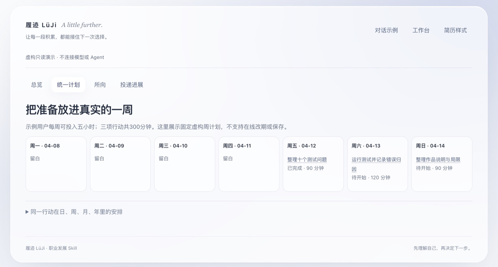

# 履迹 LüJi

[简体中文](README.md) · [English](README.en.md) · 日本語 · [한국어](README.ko.md) · [Español](README.es.md)

**使い慣れた Agent をキャリアの相談相手に：まずあなたを知り、目標を毎日できることに分けます。**

AI はいろいろな自分を想像させてくれます。履迹は、その想像を毎日の予定に落とし込みます。

この文を、普段使う Agent（Claude Code、Codex、Cursor など、ローカルファイルを読み書きできる Agent）に送ってください：

```text
请从 https://github.com/siliviasilivia85-lang/lvji-career-kit 安装并启用这个 Skill，先陪我梳理一段经历。
```

[インストールと対応する環境](references/install.md) · 一度設定すれば、あとは用件を伝えるだけです。

できること：

1. **まずあなたを知る：** レジュメ、いまの仕事、これまで行ったプロジェクトを読み、あなたが確かめられる記録にまとめます。
2. **一緒に目標を決める：** 昇進、プロジェクトを持つこと、新しい技能を学ぶこと、別の方向を試すこと、どれでも構いません。まだ整理できていなくても、まず話せます。
3. **毎日のことに分ける：** 今週ほんとうに確保できる時間で予定を組みます。忙しいときは一歩を小さくするだけで、最初からやり直す必要はありません。
4. **前回の続きから始める：** できたことは、あなたが確認してから保存します。別の対話でも、前回止まったところから続けます。



資料は自分のパソコンに残ります · 追加のモデルキーは不要です · 応募や連絡を代行しません · MIT オープンソース

## LüJi を作る理由

AI は、学びと実践のハードルを下げています。一人で試せることが増え、これまで別の職種に属していた力が交わり、組み合わされ、仕事の境界も変わりつつあります。ただ、選択肢が増えても、進む方向まで明確になるとは限りません。時間は限られたままで、何を学ぶ価値があるのか、どのプロジェクトに取り組むのか、過去の経験をどこに活かせるのかは、試しながら少しずつ見えてきます。

キャリアの成長は、仕事を探しているときにだけ起きるものではありません。昇進、より大きな責任、新しい分野への移行にも、普段の蓄積が必要です。こうした問いを AI に持ちかけることには、すでに慣れています。話を聞き、整理する助けにはなります。ただ、考えがばらばらの対話に留まっていると、Agent が参照できるのはそのとき話した一部分だけです。助言は一般的な分析に留まりやすく、対話やツールを変えるたびに、また最初から説明する必要があります。

LüJi は、キャリアを育てる方法、資料の置き場、ファイルのための道具を一つの Skill にまとめ、使い慣れた Agent に渡します。いまある経験と力を出発点に、方向を話し合い、目標に必要な知識と実践を分け、毎日確保できる時間の中へ入れます。あなたが確かめた成果、学習の記録、実際のフィードバックは保存されます。記録が増えるにつれ、経験、好み、現実の制約をより具体的に理解できるようになり、その理解はいつでも見て、補い、直すことができます。


## LüJi の仕組み

### これまで：経験を整理し、確かな根拠を残す

以前のレジュメ、仕事やプロジェクトの資料、学習メモ、学歴や受賞の記録を Agent に渡すか、ワークスペースの資料フォルダに直接入れます。Agent はテーマごとに整理し、原本と出典を保ち、具体的な経験を取り出します。漏れていたことの補足や、理解の訂正はいつでもできます。

過去の計画、実際に行ったこと、確認済みの成果は分けて記録します。自分の特徴や力を整理したいときは、Agent が実際の資料に基づく見立てを出し、あなたが確かめて直します。その見立ては、新しい実践に応じて変えることもできます。

### いま：目標を日々の仕事と学習に分ける

目の前の仕事、やってみたいプロジェクト、まだはっきりしない方向から始められます。Agent は、これまでの経験、いまの進み具合、目標に必要なこと、使える時間を踏まえ、補う価値のある知識と実践を見つけ、具体的なプロジェクト、段階ごとの成果、日・週・月の行動に分けます。

学習の進展、仕事の成果、フィードバックは、あとから少しずつ足せます。予定を見るときは既存の計画を引き継ぎ、微調整が必要なら関係する項目だけを変えます。時間が足りない、目標が変わった、うまく進まないときは、小さくするか、延ばすか、いったん止めるか、続けるかを一緒に決めます。過去の記録が揃っていなくても始められます。

### これから：進む方向を探り、キャリアの変化に備える

昇進を目指す、新しい責任を担う、別の職種へ進む、自分のプロジェクトを試す。どの方向でも、そのときの考えとともに残せます。求人票（JD）がなくても、目標について話せます。具体的な職種を検討するときは要件を集め、方向や企業の違いを比べ、これまでの経験といまの蓄積に照らして、根拠、足りない点、まだ確かめたい問いを整理します。

実際に仕事を探す段階に入り、いくつかの方向、複数のレジュメ、面接、進み具合を同時に見る必要が出てきても、同じ蓄積を使えます。

- **レジュメの作成：** 職種や企業に合わせて関連する経験と確認済みの成果を選び、独立した版として Web レジュメを作ります。レイアウトは六つあり、指定した写真を使うことも、写真なしにすることもできます。その HTML の版を確認してから、インストール済みの Chrome/Chromium で同じ版の PDF を出します。
- **面接の準備：** プロジェクトの経験談、職種の質問、伝え方の要点を整理します。企業や面接回ごとに資料を用意し、一問ずつ練習し、実際の面接のあとの振り返りも残します。
- **応募先の管理：** 企業・職種ごとの応募段階、実際に使ったレジュメの版、フィードバック、次の行動を記録します。全体の進み具合も、一つの職種や応募先だけも見られます。実際のフィードバックを「いま」に戻し、新しい練習や行動の提案につなげることもできます。

### 使い続ける：次の対話へつながるようにする

経験、行動、計画、成果は、読めるローカルファイルに保存します。あなたと Agent には、それぞれの資料マップがあります。新しい資料はフォルダへ直接入れられます。Agent は関連する問いを扱うときに、その範囲の変化を確かめ、必要なものを読みます。大切な内容は、まず具体的な下書きにし、あなたが確認してから残します。

別の対話に移ったときは、保存された取り組みの要約から、目標、止まっている箇所、次の一歩を取り戻します。Agent の理解は、あなたが保存を選んだ経験、成果、話し合いの結果に基づきます。保存していない会話は、長期記憶としては扱いません。出典を確かめ、記録を直し、理解の仕方を調整できます。

## はじめ方：一つの経験を整理してみる

最初は、よく覚えている経験を一つ選んでください。行ったプロジェクト、一時期の仕事、一つの学習で構いません。以前のレジュメの一部、振り返り、学習メモでも足ります。手元に資料がなければ、経緯を書き出すことから始められます。完全なキャリアの記録を一度に用意する必要はありません。

まだ過去の資料がなくても、いまやってみたいことから話せます。経験はあとで足せます。まだ決めていない考えだけを、独立して保存することもできます。

1. **インストールし、ワークスペースを作る。** 冒頭の文を Agent に送ってください。Skill をインストールします。資料を保存する必要が出たら、インストール先の外に個人ワークスペースを作ります（新規の場合は `~/lvji-workspace/` を推奨）。選んだ中国語または英語で、最初の案内と資料マップを生成します。中国語の入口は `从这里开始.md`、英語は `START-HERE.md` です。必要なのは最初の一度だけで、あとは普段どおり話せます。すでに手元へダウンロードしてある場合は、今のフォルダからインストールするよう頼むこともできます。ファイルの一連の操作には、ローカルファイルの読み書きと実行ができる Agent と、Python 3.10+ が必要です。
2. **その経験の資料を入れる。** ワークスペースの `past/materials/` に置きます。分類が分からなければ `inbox/` でかまいません。Agent に添付して、取り込みと整理を頼むこともできます。直接置いた原本の名前と場所は変えません。普通のメモ、PDF、Word、画像に内部用の項目を書く必要はありません。添付を正確に読めるかは、使う Agent に依存します。
3. **一緒に整理し、確かめる。** Agent が、何を行い、何を担当し、何を残したかを取り出し、出典と未確認の点を付けた経験の下書きを出します。漏れを補い、理解を直し、確認したあと、読める Markdown の記録として保存します。原本も残ります。記録の本文は自分で編集できます。タスクの日付と状態には専用の項目があるため、変更は Agent に頼むと簡単です。
4. **全体像で見てみる。** ワークベンチの生成と表示を頼んでください。「概要 → これまでの経験と現在の理解」で、いま整理した記録を開き、本文と出典を確認します。不正確なところは Agent に直してもらうか、Markdown を自分で直してページを再生成します。いまの Web ページは閲覧と選択用で、ページの中から直接保存する機能はありません。変更は Agent かファイルで行います。
5. **この蓄積から次の一歩へ。** いまやりたいことと確保できる時間を踏まえ、進める意味のあるプロジェクトや行動を話します。将来の方向に結び付けても、独立させても構いません。保存すると決めたら、統一プランで予定を確認できます。

最初の整理が終わったら、原本の場所が分かり、整理した記録を読んで直せ、次の対話から続けられる状態になるはずです。先に架空の資料で流れを知りたい場合は、[試用ガイド](examples/try-it.md) に従い、新しい一時ディレクトリで操作するよう Agent に頼んでください。

## よくある質問

**どのような Agent が必要ですか？** ローカルファイルの読み書きと実行ができる Agent です。Claude Code、Codex、Cursor など。ファイル用の道具には Python 3.10+ が必要です。会話だけの環境でも相談や下書きはできますが、ローカルへの保存までは完了できません。各環境の状況は[ホスト対応ガイド](references/hosts.md)を見てください。

**API キーは必要ですか？** 追加のモデルキーは不要です。LüJi は、使っている Agent の対話とツールの能力を使います。ローカルのファイル道具はモデルを呼び出しません。

**資料はどこに保存されますか？** 自分のパソコン上の個人ワークスペースに、読める Markdown として残ります。ソースコードと一緒には公開されません。会話の内容は、使っている Agent のいつもの方法で、そのモデルサービスに送られます。

**レジュメがなくても使えますか？** 使えます。いまやってみたいことから話し始め、経験はあとで足せます。

**仕事探しの準備をしている人だけが対象ですか？** いいえ。昇進、プロジェクトを持つこと、新しい技能を学ぶこと、別の方向を試すことも、目の前の仕事から始められます。

**別の対話に移っても覚えていますか？** 保存を選んだ内容は覚えています。経験、成果、決定、取り組みの要約です。保存していない会話は、長期記憶としては扱いません。

**毎日のタスクを通知してくれますか？** いまのところ、内蔵のバックグラウンド通知やリアルタイム同期はありません。必要なときにワークベンチを開くか、今日何をするかを Agent に聞いてください。通知の可否はホストに依存します。

**レジュメの送付や採用担当者への連絡を代行しますか？** しません。応募の進み具合は、あなたが伝えた実際の出来事に基づいて更新します。

## くわしい説明

すでに使い始めている人、ファイルの細部を知りたい人向けです。開いて読んでください。

<details>
<summary><strong>日常の資料を置く場所</strong></summary>

以下のパスは、すべて個人のキャリアワークスペース内です。新規の場合は、Skill のインストール先とは別の `~/lvji-workspace/` を推奨します。既存のワークスペースは確認済みの場所を使い続け、自動では移動しません。

| 手元にあるもの | 置く場所 |
| --- | --- |
| 以前のレジュメ、証明書、過去の仕事・プロジェクトの資料、学習メモ | `past/materials/`。テーマごとのサブフォルダを作れます |
| いま共通で使う資料、または進行中の取り組みの資料 | `present/materials/` または `present/items/<item>/materials/` |
| まだ行き先が決まっていない求人票（JD）や方向の資料 | `future/materials/` |
| ある方向・企業の応募先に関する JD、スクリーンショット、フィードバック | その方向または応募先の `materials/` |
| まだ分類が分からないもの | `inbox/` |

ワークスペースの `MAP.md` は人向けの資料マップ、`AGENT-MAP.md` は Agent の読み方です。どちらも同じ一覧から作られます。ファイルは自分で直接置けます。Agent は関連する問いを扱うときにその範囲の変化を確かめ、必要なものを読み、整理結果をあなたと確認します。ファイルを見つけたこと、内容を理解したこと、経験を確認したことは、それぞれ別の段階です。

区画の説明、資料マップ、最初の入口は、中国語または英語で生成します。実際のパスは `past/`、`present/`、`future/` のままです。マップは選んだ言語で、どこに何を置くかを説明します。自分で付けるファイル名やサブフォルダには、日本語も使えます。言語や Agent を変えても、既存の参照と版はつながり、資料を移す必要はありません。

[人向けの資料マップ（英語）](references/map.en.md) · [Agent の読み方（英語）](references/agent-map.en.md) · [ディレクトリと資料の状態](references/navigation.md)

</details>

<details>
<summary><strong>いま使える可視化</strong></summary>

**メインのワークベンチは、同じ Web ページの四つのビューです。個人ワークスペースの `views/overview.html` にまとめて生成されます。** この一つのファイルを開き、上部のタブで切り替えます。

| ビュー | 確認できること | 続きの場所 |
| --- | --- | --- |
| **概要** | 進行中の取り組み、今日の行動、最近の学習と仕事の進展。完了・一時停止した取り組み、考え、節目の振り返りも展開できます | 取り組みと出典を開く。過去の記録は「これまでの経験と現在の理解」で展開します |
| **統一プラン** | 日ごとの行動、週・月のカレンダー、年の月カード、対応する計画の説明と実際の記録 | 時間の単位を切り替え、行動を確認する。予定を変えるときは Agent に頼む |
| **目指す方向** | 横並びにしたキャリアの方向、関連する要件と根拠の支え、資料の揃い具合、自分の好み | 並べ替えて比べ、方向や企業の JD 詳細へ入り、レジュメと面接資料を見る |
| **応募状況** | 各企業の応募先がどの段階か、次の行動、履歴、実際に使ったレジュメの版、フィードバック | すべての応募先を見るか、方向・企業・応募先・段階で絞る。使った版が記録されていなければ、空のまま明示します |

独立した画面だと勘違いしやすいものもあります。

- **過去の経験**は概要の中で展開します。いまのところ「過去」という独立した最上位ページはありません。原本と整理の状態は `MAP.md` で探します。
- **面接資料**は、方向や応募先の詳細の中から開きます。面接だけの別ホームページはありません。
- **Web レジュメ**は、独立して残す HTML です。職種共通版は `future/roles/<role>/common/resumes/<version>/`、企業版はその応募先の `resumes/<version>/` にあります。詳細の「既存のレジュメ版」から入れます。六つのテンプレートは六つのレイアウトであり、六つのワークベンチではありません。

ページは、保存済みのファイルから必要に応じて生成します。絞り込み、並べ替え、閲覧はページ内でできます。本文、タスクの日付、応募の状態を変えるときは Agent に差分を出してもらい、確認してから更新するか、Markdown を自分で直します。「Agent に調整を頼む」は、依頼文をコピーする互換用の入口です。日常は、ページから指示をコピーする必要はありません。いまのページは資料へ直接書き戻さず、ドラッグで予定を保存する機能もありません。

絞り込みは、目の前の表示だけを変えます。完全なスナップショットには、生成時に読み取った職業資料が含まれます。職種ごとに分離された共有リンクではありません。外に見せる必要があるときは、含める範囲をはっきりさせた別の資料を Agent に作ってもらってください。

入口、生成の仕方、実際にできる操作は[可視化ガイド](references/views.md)にまとめています。テンプレートのソースは `assets/md_workspace.html` で、ワークスペースのデータを入れて初めて使えるページになります。自分の資料を探すためにテンプレートを直接開く必要はありません。

### レジュメのレイアウトは先に見比べられます

レジュメを作る前に、架空のスタイルギャラリーを生成してもらえます。同じ経験を、自己紹介サイドバー、クラシックな一段組、根拠を整理した形式、簡潔なテキスト、プロジェクト優先、経験優先の六つのレイアウトで見られます。AI が生成した架空の顔写真を二種類切り替えたり、写真なしにしたりできます。選んだらレイアウト名を Agent に伝え、自分の経験と写真に差し替えます。

ギャラリーには、GitHub 上の Web レジュメの参考も七つあり、公式の例、用途、ライセンスへのリンクを示します。内蔵の六レイアウトとは別に示す外部参考です。入口と生成方法は[レジュメの流れ](references/resume.md)を見てください。

</details>

<details>
<summary><strong>架空のデモサイト</strong></summary>

ローカルデモ内の対話は、架空の例であることを明示しています。デモは「経験を整理する → 方向を探る → 行動に分ける → 蓄積を残す」をつなぎ、その結果としてプラン、方向、レジュメを開きます。デモの Web ページ自体はオンライン Agent を動かさず、閲覧者の資料も保存しません。

管理者は、静的ホスティング向けの版を生成できます。

```text
python3 scripts/demo_site.py --output _site
```

出力先は新しいディレクトリである必要があります。デモに含まれるのは架空の読み取り専用ページとローカルの素材だけで、本機のパス、個人ワークスペース、実行履歴は出しません。リポジトリ作成後、Pages で GitHub Actions を選び、[デモ公開ワークフロー](.github/workflows/pages.yml) を手動で実行できます。アップロードするのは `_site/` だけで、リポジトリ全体や職業資料のディレクトリは公開しません。ワークフローの準備ができていることは、すでに公開サイトがあるという意味ではありません。

</details>

<details>
<summary><strong>ファイルの残し方</strong></summary>

```text
lvji-career-kit/              ダウンロードする Skill パッケージ
├── README.md                利用者向けの説明
├── README.en.md             English guide
├── README.ja.md             日本語のガイド
├── README.ko.md             한국어 안내
├── README.es.md             Guía en español
├── SKILL.md                 Agent の作業入口
├── AGENTS.md                フォルダでの共同作業の入口
├── references/              資料、計画、方向、レジュメ、面接、ビューの手順
├── prompts/                 特徴の整理、差分分析、面接準備、振り返り用の指針
├── scripts/                 ローカルファイルを扱う道具
├── assets/                  変更できるページテンプレート
└── examples/                少量の架空の試用資料

~/lvji-workspace/             Skill のインストール先とは別に置く個人の職業資料。ソースとは一緒に公開しない
├── MAP.md               資料マップ
├── AGENT-MAP.md         Agent の案内
├── 从这里开始.md         中国語ワークスペースの最初の入口。英語は START-HERE.md
├── inbox/               分類前の資料
├── past/                これまでの経験と学習
├── present/             いまの取り組み、行動、計画、考え、節目の振り返り
├── future/roles/        方向、企業の応募先、レジュメ、面接資料
├── views/overview.html  統一した可視化ワークベンチ
└── .luji/               道具が管理する下書き、履歴、案内のキャッシュ
```

経験と行動には、それぞれ元になるファイルがあります。異なる方向や日・週・月のプランは、同じ蓄積を参照します。別の対話では、Agent は保存された取り組みの要約から、目標、止まっている箇所、次の一歩を取り戻します。保存していない会話は、長期記憶としては扱いません。原本は自分で管理でき、整理したファイルも見て直せます。

記録の本文は自分で編集できます。行動の日付と状態の根拠は、メタデータの `scheduled_for`、`due_on`、`status` です。本文の日付だけを変えても、予定は変わりません。Agent に一部分の調整を頼むことができます。自分で編集するときは、安定した ID、正しい JSON の値、既存の履歴を保ってください。

まだ目標と呼べない考えは、`present/notes/` に置けます。仕事、学習、応募が一段落したら、`present/stages/` に節目の振り返りを残せます。実際の成果を参照し、選択の変化を記録し、次の段階へ何を持っていくかを決めます。振り返りを保存しただけで、取り組みを終了したり、次のタスクを自動で組んだりはしません。

新しい対話では、自分のワークスペースを直接開けます。検証できる Skill の場所が記録されています。あとで Skill パッケージを移したら、[案内の再接続](references/navigation.md) に従ってつなぎ直すよう Agent に頼んでください。職業資料を作り直す必要はありません。

</details>

<details>
<summary><strong>使える範囲と現在の進み具合</strong></summary>

LüJi は、使っている Agent の対話、添付の理解、ツールの能力を使います。独立したモデルサービスは付きません。ローカルのファイル道具にモデルキーは不要です。完結した使い勝手は、ホストの読み書き・実行・表示の能力に依存します。ページは、ホストのファイルパネル、対話、ブラウザで見られます。いまは生成時刻の付いたローカルスナップショットです。

レジュメは六つのレイアウトがあり、初期値は簡潔な二段組です。写真は任意で、内容は実際の出典を保ちます。その HTML の版を確認したあと、インストール済みの Chrome/Chromium で同じ版の PDF を出せます。面接の準備も同じ経験と成果を使います。詳しくは[レジュメの流れ](references/resume.md)と[面接の流れ](references/interview.md)を見てください。応募の進み具合は、あなたが伝えた実際の出来事で更新します。レジュメの自動送付や採用担当者への連絡はしません。

生成のたびに独立した版を残します。PDF の出力記録は、その版とファイルに結び付きます。信頼できる記録のない古い PDF や手作業のファイルは、未検証と表示します。テンプレートを更新しても、壊れていない過去の HTML は無効になりません。職業の出典が変わったかどうかは別に伝えます。応募の履歴には、実際に使ったレジュメファイルを関連づけられます。分からないときは未記録とし、最新版だと推定しません。

README は簡体字中国語、英語、日本語、韓国語、スペイン語があります。ワークスペースの最初の案内と利用マップは、いまのところ中国語と英語で、初期設定では `zh` または `en` を選びます。Agent とは自分の言語で話せますが、実際の理解はホストに依存します。実際のディレクトリ名は互換のままです。Web ワークベンチの固定文言は、いまも主に中国語で、操作の手順書も主に中国語です。この README の翻訳は、画面全体の多言語化が終わったことにはなりません。

いまのところ、内蔵のバックグラウンド通知やリアルタイム同期はありません。通知や音声などはホストに依存します。各ホストに必要な能力、表示の代替、実際に確認した範囲は[ホスト対応ガイド](references/hosts.md)にあります。旧形式のワークスペースは残し、自動では移行しません。テストと未確認の項目は [TESTING.md](TESTING.md) を見てください。

</details>

試用資料はすべて架空です。個人の職業資料はソースと一緒には配布しません。ページと道具の出典は [ASSETS.md](ASSETS.md)、ライセンスは商用利用も可能な [MIT](LICENSE) です。
